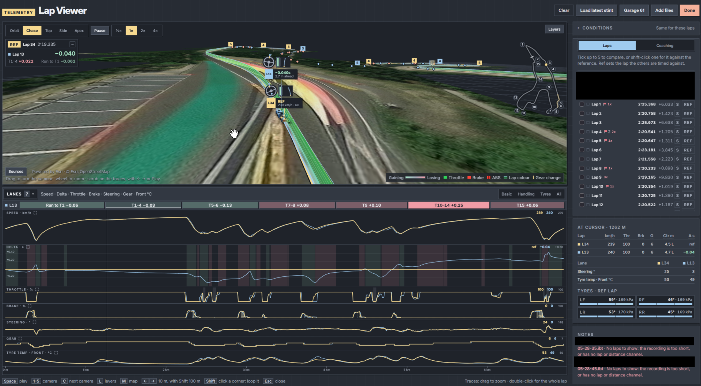
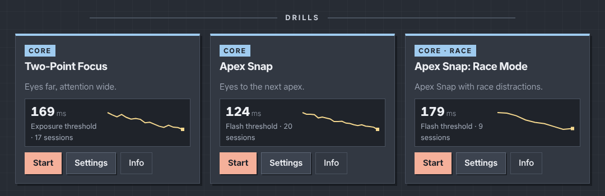
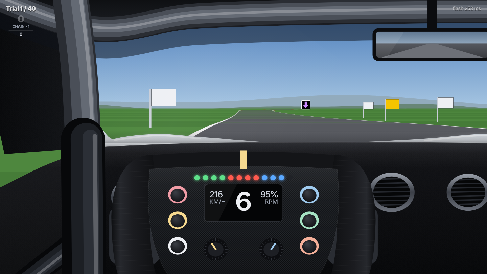
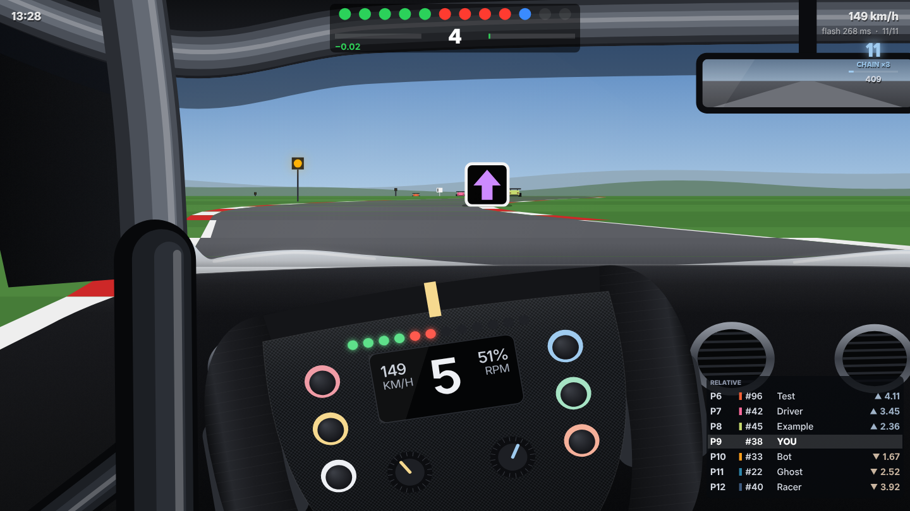
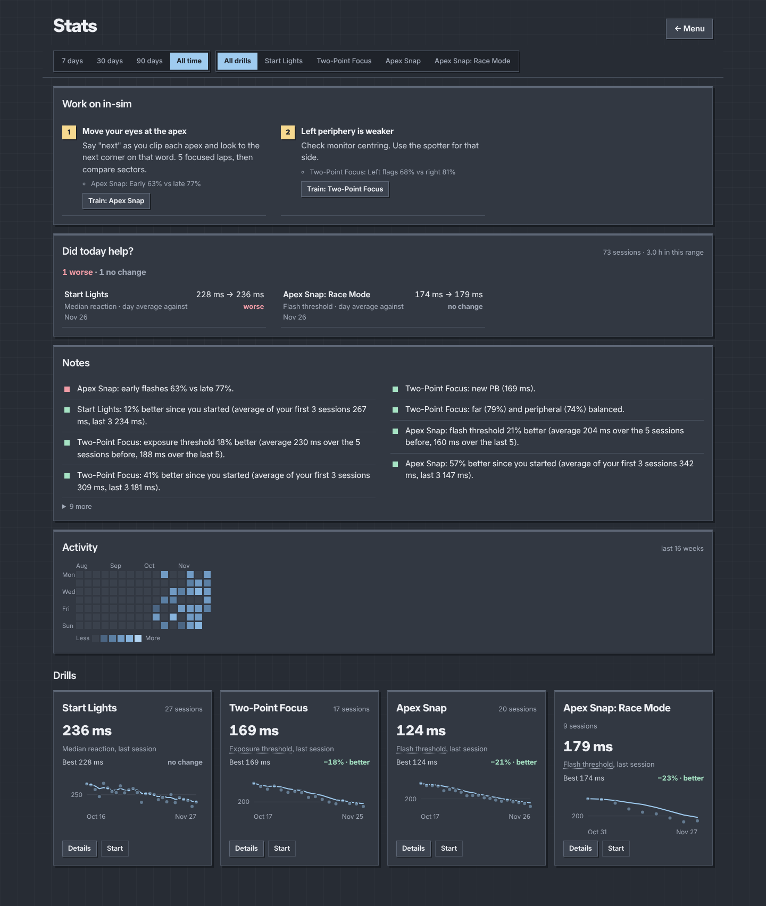

# iSlopTrain: I got tired of all the setup shops charging for slopapps that u have to download, so I slopped together one u can use anywhere

> [!WARNING]
> ## ⚠️ This project is vibecoded
>
> **Almost all of the code in this repository was written by an AI coding assistant**, directed through prompts rather than typed by hand. Treat it as experimental software: expect rough edges, and review anything before you reuse it.
>
> ### AI disclosure rating: **AI-dev-B**
>
> Rated on the scale proposed by Benn Jordan in [*We Should Standardize Vibe Coding Ethics*](https://www.bennjordan.com/blog/we-should-standardize-vibe-coding-ethics). **AI-dev-B** means AI-written code is used throughout the software, including in areas that an experienced developer could not fully verify or understand.
>
> | Rating | Meaning (summarised) |
> |---|---|
> | NoAI | No AI used at all |
> | AI-aux | AI used only for auxiliary tasks (workflow, tooling); no AI-written code |
> | AI-UI | AI-written code limited to the UI or graphics |
> | AI-dev-A | AI-written code throughout, verified and understood by an experienced developer |
> | **AI-dev-B** ◀ | **AI-written code throughout, including parts the developer can't fully verify** |
> | AI-dev-C | Mostly AI-written, supervised by a novice developer |
> | AI-V | Entirely AI-written; support depends on AI |

A browser sim-racing toolkit with two halves:

- **Lap Viewer:** drop in iRacing, MoTeC or Garage 61 telemetry and compare laps on a 3D track map, with traces, gaps and car cues.
- **Training drills:** short, adaptive vision, mind and reflex drills, with a stats page that tracks your progress.

No dependencies, no build step: plain HTML + Canvas 2D / WebGL + classic scripts.

## Run it

Open `index.html` in Chrome/Edge (works from `file://`), or serve the folder:

```powershell
python -m http.server 8765
```

then go to http://localhost:8765. Run fullscreen on the monitor you race on and set each drill's FOV to match your sim.

## Lap Viewer: 3D telemetry review

The app opens on the **Review** tab.



**Review → Lap Viewer** opens telemetry from a sim and draws the laps on a 3D track map. Files are read in the browser (in a Web Worker for big files); telemetry is never uploaded or saved. With **Map** on, the track's location (or, for sims without GPS, its name) is sent to OpenStreetMap and Esri for the real track centreline and satellite ground (common iRacing circuits come bundled in [data/tracks](data/tracks/README.md), so only the imagery is fetched for those); lines that clip an apex then show off centre.

- **Formats:** iRacing `.ibt`, MoTeC `.ld` (drop the matching `.ldx` with it for lap markers), and CSV (MoTeC i2 export, Garage 61, SimHub and others; columns are matched by name and units converted). **Try a demo session** generates one if you have no file to hand.
- **Conditions:** a foldable panel at the top of the side column lists the compared laps' track and air temperature, wetness, rain, rubber, wind, humidity and sky, from `.ibt`, Garage 61 or CSV, and flags the ones that differ enough to matter.
- **Garage 61:** the **Garage 61** button walks you through exporting a lap's CSV on garage61.net and dropping it in. Optionally, a bookmarklet fetches laps with your own API token on garage61.net itself and sends them back (the token stays there, requests go one at a time, at most five laps per send).
- **Laps:** split by lap number, lap distance or beacons, timed to the crossing, and lined up by distance. The fastest full lap is the reference; tick up to five laps to compare.
- **3D view:** the track (the laps' average path) with elevation, each lap's line in its own colour and dash pattern with lap tags along it, throttle (green) and brake (red) drawn up from each line as fences topped with the lap's colour (all laps, one, or off), and a numbered post at every gear change. Optional steering lean and elevation scale.
- **Cars and gaps:** a car for each lap where it was at the reference's time, so their spacing is the gap; each carries a chip with the delta to the reference and the gap in metres. The wheels turn at their own wheel speed (a locked one stops) and, with Wheel data on in Layers, show tyre temperature across the tread (blue cold, glowing red hot) and a rose or mint rim while locking or spinning. Without those channels they roll with the road and stay plain. Above each chip a steering wheel turns with the lap's wheel angle, with a sky (understeer) or peach (oversteer) strip on its rim for the extra or missing lock (Balance, METHODOLOGY 8.2). Passthru in Layers draws bodywork faint wherever it hides a wheel, so closed-wheel cars show their tyres too. With two or more laps ticked, a card in the corner gives each lap's gap and the time it lost on the current and last stretch.
- **Cameras (keys 1-5, C cycles):** Orbit; Chase; Top (straight down, travel direction up: track position against the reference); Side (inputs side-on); Apex (a trackside camera at each corner that pans and zooms with the car; a chicane or corner sequence gets one higher camera past its last apex). Drag turns a follow camera round the car, wheel zooms. Play the lap at ½×-4×.
- **Traces:** speed, delta to the reference, throttle, brake, steering and gear against distance, sharing one cursor with the 3D view and the readout.

Not yet: per-corner mistake finding (brake points, minimum speed, coasting) and jump-to-corner. Track edges are estimated, since telemetry has none.

## Training drills

A growing suite of short, adaptive sim-racing training drills, grouped into three tabs:

- **Vision:** getting your eyes to the next apex early and keeping attention wide.
- **Mind:** holding the apex under threat, recovering from a run of mistakes and reading the racing line.
- **Reflex:** start reactions and a daily readiness check.

The drills draw on driver eye-tracking research, sport psychology, vehicle-dynamics modelling and established motor-learning principles. More modules are planned. See [docs/METHODOLOGY.md](docs/METHODOLOGY.md).



### Drills

| Drill | Tab | Trains | Primary metric |
|---|---|---|---|
| **Start Lights** (warm-up) | Reflex | Alertness, simple visual reaction, no anticipating | Median reaction (ms) |
| **Two-Point Focus** | Vision | Far fixation + peripheral near-field awareness (UFOV-style) | Exposure threshold (ms) |
| **Apex Snap** (core) | Vision | "Clip the apex → eyes to the next apex" reflex at speed, optional peripheral dual task | Flash threshold (ms), Snap score |
| **Apex Snap: Race Mode** (under load) | Vision | The same reflex with traffic (brake lights, car alongside), a relative timing box, dash (shift lights, delta, warnings), engineer radio, spotter calls, optional engine/speech audio. Confirm only for threats (go/no-go) | Load cost (ms), threats caught |
| **Eyes Off the Wall** | Mind | Holding the apex while a threat on the outside competes for your eyes: walls, wrecks, waved yellows, spinning cars. Threat level adapts between sessions. Optional self-talk comparison | Eyes captured (%), threat cost |
| **Eyes Off the Wall: Call the Hazard** | Mind | The same, plus a go/no-go call: press Confirm for a wreck, a waved yellow or a spinning car, never for a wall. The flash shows whether you looked to make the call | Seen, not stared (%), hazards called |
| **Clean Slate** | Mind | Recovering from a run of errors. Rhythm-game lane: rows of arrows scroll to a hit line on a beat; press the blue arrow's direction (orange = opposite) in the hit window, with a chain multiplier and timing grades. Unannounced bursts (squeeze, rush, clutter, flip, double hit) force real mistakes, then difficulty snaps back so the dip afterwards is yours. Burst and distraction ladders (1-6) adapt between sessions. Optional reset cue | Recovery (rows), error chaining, post-error shift |
| **Draw the Line** | Mind | Placing the car through a corner complex. Draw the line you'd drive from the approach to the straight; it's read for intent (hand wobble smoothed out, then polished within ±1 m of your drawing), run through a lap-time model and judged corner by corner against the minimum-time line: early / late turn-in or apex, road left unused at entry, apex and exit, the wrong corner prioritised, and the time each corner cost. The level sets the pass mark. Then replay your line or the ideal from the driver's seat beside the top-down view and a speed trace, paused at braking, turn-in, apex and track-out | Line level, lines passed (%), corners placed right (%) |
| **Class Traffic** | Mind | Responsible calls in multiclass traffic, from both sides of the speed gap. A prototype closing on a GT down a long straight into a corner; you're one of them (alternating, or fixed in settings). Prototype: pass on the straight, out-brake on the inside, round the outside, or follow it through. GT: hold your line, ease off and let it by, leave room, move across, move over under braking, cover the inside. Every option is driven by a two-car model (each car's own lap-time profile, car following, contact / squeeze / cut-off detection), so the time lost and the risk are computed. Pick a blue-flag rule set before the run (hold your line, give way, point-by; differences under Info). Replay any option from your seat, with a mirror, beside the top-down view and a gap trace | Traffic level, call score (%), best calls (%), risky picks (%) |





Circuits are generated fresh each run from a corner vocabulary: kinks, sweepers, tight corners, hairpins, decreasing- and increasing-radius corners, chicanes, esses and double apexes. Each driving drill also has **Track** (Mixed / Technical / Fast) and **Elevation** (Flat / Rolling / Hilly, with blind crests and compressions) settings. The corner types, mixes and elevation profiles are defined in `track.js` (`CORNER_TYPES`, `MIXES`, `ELEVATION`).

Guided sessions chain drills across all three trainers and live on their own **Sessions** tab:

- **Quick:** Pre-drive (~3 min), Line check (~5 min), Reset (~4 min)
- **Daily:** Daily vision (~8 min), Daily mind (~10 min), Full circuit (~15 min)
- **Pressure:** Race pressure (~7 min), Composure (~9 min), Racecraft (~10 min)
- **Multiclass:** Race briefing (~6 min), Prototype stint (~9 min), GT stint (~9 min), Quick calls (~6 min), Rule switch (~10 min)

Each is a `registerSession` entry in `js/sessions.js` with a `group`, a one-line `blurb`, per-step setting overrides and an optional step `note` shown on the card. A session that names an unregistered drill is hidden, so playlists can be written ahead of a drill landing.

Controls: arrows / WASD to answer, Space / Enter to confirm, Esc to pause, **F** to toggle fullscreen (never automatic unless enabled under Data). Standard gamepads work automatically. Wheels and button boxes can be bound under **Controls** (buttons, POV hats, axes).

**Game feel:** every drill builds a chain with multiplier tiers, scores points (with bonuses for early snaps, short flashes and fast starts), plays rising tones and calls out new best chains and PB pace. The results screen grades each session S / A / B / C against your own history, with record badges, a score count-up and a short highlight on records. **Data → Game feel** sets Full, Silent or Off; "summary only" feedback keeps it hidden during a drill. Design rules: METHODOLOGY section 5c.

### Stats page

**Stats** in the header (or **Full stats →** on any results screen) opens an aim-trainer-style dashboard:



- **Filters:** time range (7 / 30 / 90 days / all) and drill. They scope everything below them.
- **Overview:** sessions, training time, active days, current streak, and an activity calendar.
- **Notes:** what got better or worse (recent block vs the previous block), new personal bests, plateaus, consistency, and readiness ("slower than your norm today").
- **Work on in-sim:** prioritised advice for real driving, generated from your weakest areas, with the evidence behind each item and a button to keep training it. Examples: early-flash misses, weak corner types (hairpins, chicanes, decreasing radius…), left/right asymmetry, high-speed corners, blind crests, tunnel vision, HUD load cost, missed spotter threats, jump starts.
- **Per-drill deep dive:** primary metric (sessions plus 5-session average, PB marked), small multiples for every other metric, weak-spot breakdowns, and a full session table.

Apex Snap breakdowns: accuracy by flash timing, corner type, left/right, approach speed and blind crest. Eyes Off the Wall: where your eyes were on hazard probes, clean vs hazard corners, accuracy and capture by hazard type, sudden vs already-there hazards, and capture by self-talk cue. Draw the Line: lines passed by corner complex and which placement mistakes you make most. Class Traffic: responsible calls by situation and by rule set, and which wrong calls you pick. Clean Slate: recovery curves (accuracy and speed for the 8 rows after a burst, recent vs earlier sessions), rows to recover by burst type, error rate after a correct answer vs after an error, blue vs orange accuracy, accuracy by distraction type, and reset cue vs none. Two-Point Focus: far vs peripheral, and flag side. Start Lights: reaction-time distribution.

Per-trial detail is stored for the latest 50 sessions of each drill, and summaries for the latest 300. Drills plug into the stats page through an optional `analyze(results, A)` on their definition (see `js/core/analysis.js`).

## Structure

```
index.html            page shell + script order
css/style.css         styles + type scale (Allo variable font, weight/roundness axes)
fonts/allo/           Allo by Josh Puckett (SIL OFL 1.1, see OFL.txt)
js/core/ist.js        namespace (window.IST) + drill/session registry
js/core/util.js       math, stats, seeded RNG, DOM helper
js/core/storage.js    localStorage persistence (summaries, settings, bindings)
js/core/staircase.js  adaptive 2-down/1-up staircase
js/core/input.js      keyboard + gamepad/wheel -> abstract actions, binding learner
js/core/runner.js     canvas, loop, pause, drill lifecycle
js/core/analysis.js   trends, PBs, weak spots, in-sim advice library (TIPS)
js/ui/charts.js       dependency-free SVG charts (line, bars, histogram, calendar) with hover tooltips
js/ui/stats.js        Stats page
js/ui/view-settings.js  View screen (in-car view setup with live preview)
js/render/symbols.js  arrows, pattern masks, boards, flags, HUD text
js/render/canvas-ui.js  the palette (IST.Theme) and page-style canvas widgets (IST.CanvasUI)
js/render/track.js    procedural circuit + speed profile + racing line + pseudo-3D renderer (themes)
js/render/cockpit.js  vector cockpit drawn over the in-car view
js/render/view.js     shared in-car view settings (FOV, horizon, seat, cockpit)
js/components/race-layer.js  reusable race clutter: traffic, relative box, dash, radio/spotter, audio
js/components/hazard-layer.js  outside-of-corner threats with a decoy board (walls, wrecks, yellows, spins), threat levels
js/components/juice.js  shared game feel: chain tiers, score, grades, tones, callouts
js/components/line-lab.js  corner complexes, lap-time model, minimum-time line solver, flawed lines, top-down drawing
js/components/traffic-lab.js  multiclass traffic model for Class Traffic (prototype, GT, optional third car): car following, contact / squeeze / cut-off detection, questions
js/drills/*.js        one file per small drill
js/drills/*/          one folder per large drill (content, ui, replay, scene, screens, stats, drill)
js/sessions.js        guided session playlists
js/app.js             menu, settings, controls, data, results (all generated from definitions)
js/review/            Review tab: telemetry import (telemetry/), lap comparison, trace strip, WebGL viewer (gl/), page
css/review.css        Review tab styles
tests/                `node --test`: model checks + every drill played headless (see tests/README.md)
```

How the pieces fit together, and where to look when something breaks: [docs/ARCHITECTURE.md](docs/ARCHITECTURE.md).

## Adding a drill (or an alternative interface)

Create `js/drills/my-drill.js`, add a `<script>` tag before `sessions.js`, and register it:

```js
IST.registerDrill({
  id: 'my-drill', name: 'My Drill', category: 'Core', tagline: '…', description: '…',
  research: [{ point: '…', source: '…' }],
  settings: [{ key: 'trials', label: 'Trials', type: 'number', default: 30, min: 5, max: 100 }], // number | select | bool
  metrics: [{ key: 'threshold', label: 'Threshold', unit: 'ms', digits: 0, better: 'lower', primary: true }],
  coach(summary) { return ['tip…']; },
  create(ctx) {               // ctx: settings, history, W, H, clock(), frameInterval(), finish()
    return {
      update(dt, clock, ts) {},
      render(g, W, H, ts, paused) {},
      onAction(action, t) {},  // 'up'|'down'|'left'|'right'|'confirm'
      onPause() {},
      result() { return { summary: { threshold: 123 } }; },
    };
  },
});
```

The menu card, settings form, "why it works" panel, results table, deltas vs last session, trend line and coaching all come from the definition. To try a different look for an existing drill, either add a theme to `THEMES` in `track.js` (exposed via the `style` setting) or copy the drill file under a new `id` and change its rendering.

Variants can share one `create()`: `apex-snap.js` registers a base definition and a Race Mode copy (`Object.assign({}, BASE, RACE)`) that sets `raceMode: true` and adds settings/metrics. `IST.RaceLayer` can be bolted onto any driving drill the same way. `eyes-off-wall.js` does the same from another tab: it copies `IST.ApexSnap.BASE`, sets `hazardMode: true` and `tab: 'mind'`, and supplies `levelFor()` and `hazardSummary()` for `IST.HazardLayer`.

Each drill instance exposes `debug()` for dev-tools inspection and automated checks.

A drill that grows large can be split into a folder: see "Large drills are folders" in [docs/ARCHITECTURE.md](docs/ARCHITECTURE.md). Run `node --test` after any change; `tests/drills.test.js` plays every registered drill automatically.

## Data

Stored in this browser's localStorage under `isloptrain.v1` (session summaries, recent per-trial detail, settings, bindings).
